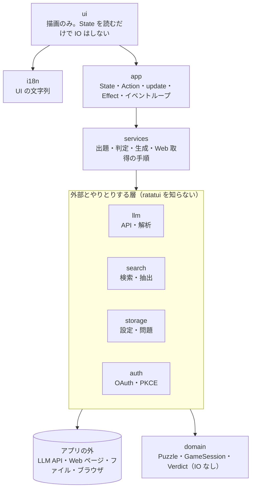

# situation-puzzle-tui 実装計画書

最終更新: 2026-11-21

## 概要とゴール

ターミナル上で「ウミガメのスープ」を遊び、作り、集められるTUIアプリを、Rust と ratatui で段階的に作る。LLM が出題者になり、プレイヤーの質問に Yes / No / Irrelevant などで答え、最終解答を判定する。

この計画は全体の構造と実装の順番を示すもので、細部は実装しながらエージェントに相談して決める。学習面のゴールは次の4つで、各フェーズはこれを意識して組んである。

| ゴール | このプロジェクトでの具体的な形 |
| --- | --- |
| こなれた Rust | 状態を enum と型で表し、`unwrap` に頼らずエラーを `Result` で扱う |
| しっかりしたテスト | ロジックは単体テスト、画面はスナップショット、HTTP はモックサーバーで検証する |
| きちんとした構造 | 純粋なロジック・外部IO・UI を別モジュールに分け、依存の向きを一方向に保つ |
| 美しい見た目 | 色とスタイルを theme に集約し、全画面で一貫した見た目と操作感にする |

## 仕様の決定事項

LLM 接続は「OpenAI互換API（BYOK）」と「Sign in with ChatGPT」の2本立てで、Web検索はアプリ側で実装する。これまでの質問で決まった仕様は次のとおり。

| 項目 | 決定 | 補足 |
| --- | --- | --- |
| 問題の作成 | 手動で書く、LLM に生成させる、の両方 | 生成した問題は Editor で確認・修正してから保存する |
| Web からの取得 | LLM が Web 検索で問題を探す | 検索そのものはアプリが行い、LLM には結果だけを渡す（アーキテクチャの章） |
| 出題 | LLM が出題者として回答・ヒント・解答判定を行う | 回答は Yes / No / Irrelevant / Partially の4種類 |
| LLM 接続（BYOK） | OpenAI 互換の Chat Completions 形式なら何でも | base URL・モデル名・API キーを設定する。DeepSeek や Ollama も対象 |
| ChatGPT ログイン | OpenAI 公式の Sign in with ChatGPT を使う | ChatGPT Plus / Pro が必要。Responses API 経由で呼ぶ |
| UI の言語 | 当面は英語。将来、設定で切り替える | 最初から UI 文字列を1か所に集めておく |
| 問題文・LLM の返答 | 言語は自由 | 問題ごとに言語を持たせ、LLM はその言語で答える |
| 遊び方 | シングルプレイ | マルチプレイは対象外 |
| 保存先 | ローカルのファイル | 設定・問題とも TOML（人が読み書きしやすい） |
| エージェントの関わり方 | 方針の提案と短いコード例まで | 詳細は AGENTS.md |

## 画面構成

画面は6つで、Home から各画面へ移動し、Esc で戻る。

| 画面 | 役割 |
| --- | --- |
| Home | メニュー。最近遊んだ問題と、使用中の LLM プロファイルを表示する |
| Library | 保存済みの問題の一覧。絞り込み、遊ぶ、編集、削除 |
| Play | 出題画面。質問の入力、回答の履歴、ヒント、最終解答、ギブアップ |
| Editor | 問題の手動作成と編集。LLM が生成した問題もここで確認してから保存する |
| Discover | キーワードから Web 上の問題を探し、候補を選んで取り込む |
| Settings | LLM プロファイル、検索プロバイダ、ChatGPT ログイン、UI 言語、テーマ |

出題画面（Play）のイメージは次のとおり。上から問題文、質問と回答の履歴、入力欄、キー操作の案内を並べる。

```text
╭─ The Glass of Water ──────────────────────── Q 12 · Hints 1/3 ─╮
│ A man asks a bartender for a glass of water.                   │
│ The bartender pulls out a gun. The man says "Thank you"        │
│ and leaves. Why?                                               │
╰────────────────────────────────────────────────────────────────╯
╭─ Questions ────────────────────────────────────────────────────╮
│  10  Was the man thirsty?                     ● NO             │
│  11  Did the bartender want to help him?      ● YES            │
│  12  Is the bar's location relevant?          ○ IRRELEVANT     │
│      ⠋ Thinking…                                               │
╰────────────────────────────────────────────────────────────────╯
╭─ Ask ──────────────────────────────────────────────────────────╮
│ > Was the gun meant to scare him?▏                             │
╰────────────────────────────────────────────────────────────────╯
 Enter ask · Ctrl+T hint · Ctrl+A answer · Ctrl+G give up · Esc back
```

回答の種類ごとに色と記号を固定し、一目で Yes / No がわかるようにする。キー割り当ては仮で、Ctrl+H は多くの端末で Backspace と区別できないので使わない。

Discover の候補一覧と「生成してすぐ遊ぶ」では真相を隠し、ネタバレしないようにする。

## 全体アーキテクチャ

依存は「UI → アプリ → サービス → LLM・検索・保存 → ドメイン」の一方向にし、ドメインは外部に何も依存しない。最初は単一のクレート（`lib.rs` + `main.rs`）の中で、モジュールによって層を分ける。



矢印は「使う側 → 使われる側」。ui と app は domain の型を直接使ってもよいが、domain から上の層への依存は作らない。

### モジュール構成

```text
situation-puzzle-tui/
├── AGENTS.md
├── Cargo.toml
├── docs/PLAN.md          この計画書
├── src/
│   ├── main.rs           起動と終了の処理だけ
│   ├── lib.rs
│   ├── app/              State・Action・update・Effect・イベントループ
│   ├── ui/               描画のみ（theme.rs、widgets/、screens/）
│   ├── i18n/             UI の文字列
│   ├── domain/           問題とゲーム進行（puzzle.rs、game.rs）
│   ├── services/         出題・判定・生成・Web 取得の手順
│   ├── llm/              クライアント、プロンプト、応答のパース、SSE
│   ├── search/           Web 検索プロバイダと本文抽出
│   ├── auth/             Sign in with ChatGPT（OAuth / PKCE）
│   └── storage/          設定と問題の保存
└── tests/                結合テスト
```

### 依存のルール

`domain` は ratatui・tokio・reqwest を使わず、問題とゲーム進行のルールだけを持つ。`ui` は `&State` を受け取って描画するだけで、IO も状態の変更もしない。`llm`・`search`・`storage`・`auth` は ratatui を知らない。

境界が固まってきたら、Cargo workspace で複数クレートに分けると、このルールをコンパイラに守らせられる。最初は単一クレートで十分。

### イベントループと非同期

ratatui のドキュメントでも紹介されている The Elm Architecture（TEA）を使う。キー入力も LLM の結果もすべて `Action` になり、`update` が `State` を更新して、必要な副作用を `Effect` として返す。

Effect（LLM 呼び出し、保存など）は `tokio::spawn` で実行し、結果はチャネル経由で `Action` として戻る。こうすると UI が応答待ちで固まらず、`update` を端末なしでテストできる。

```rust
// 擬似コード: 形のイメージだけ
loop {
    terminal.draw(|frame| ui::render(frame, &state))?;
    let action = tokio::select! {
        Some(event) = terminal_events.next() => keymap::to_action(&state, event),
        Some(action) = results_rx.recv() => action,
        _ = tick.tick() => Action::Tick,
    };
    for effect in app::update(&mut state, action) {
        effects::spawn(effect, results_tx.clone());
    }
    if state.should_quit() { break; }
}
```

### LLM 層

BYOK は Chat Completions 形式、ChatGPT ログインは Responses API と、形式の違う2つのバックエンドを持つ。アプリ内部では共通のメッセージ型を使い、送信直前に各形式へ変換する。

バックエンドの切り替えは、まず `enum LlmBackend { ChatCompletions(..), ChatGpt(..), Fake(..) }` のような enum で書くのがおすすめ。`async fn` を持つ trait は `dyn` で使いにくいので、enum の方が素直に書ける。Fake はテストと開発用。

プロンプトは `llm::prompts` に関数として集め、出力形式は JSON を指示する。応答は `llm::parse` で構造体に変換し、コードフェンスや前後の余計な文があっても読めるようにする。出題者の応答はたとえば次の形になる。

```json
{ "verdict": "no", "comment": "Think about why he wanted water." }
```

### Web 検索（Discover）

ChatGPT プランのルートでは OpenAI 側の検索ツールが使えず、互換プロバイダにも共通の検索機能はない。そのため検索はアプリが行い、LLM には検索語の作成と結果の読み取りだけを任せる。

手順は、LLM がキーワードから検索語を作る、`SearchProvider` で検索する、ページを取得して本文を抽出する、LLM が問題を JSON で抜き出す、真相を隠して候補を表示する、選んだものを Editor で確認して保存する、の順。function calling で LLM 自身に検索させる方式は、この手順が動いてからの発展課題にする。

検索プロバイダは trait にして差し替えられるようにする。候補は API キーが必要なサービス（Tavily、Brave Search API など）か、自分で立てる SearXNG。

### 認証

認証情報は `enum Credentials { ApiKey(..), ChatGpt(..) }` で表す。API キーは設定ファイルに平文で書かず、環境変数名を指定するか、OS の鍵管理（keyring）に入れる。

Sign in with ChatGPT は PKCE 付きの OAuth 認可コードフローで、`127.0.0.1:1455` に小さなサーバーを立ててリダイレクトを受け取る。初回は `dynamic_agent_client` でクライアントを登録し、`chatgpt.tokens.use.direct` スコープが許可されたかを確認してから使う。アクセストークンは1時間で切れるので、期限前にリフレッシュする。

### UI の言語（i18n）

UI 文字列は `enum Text { Ask, GiveUp, QuestionCount(usize), .. }` のような型で管理し、言語ごとの関数で文字列に変換する。日本語を足すとき、`match` の書き忘れがコンパイルエラーになるので翻訳漏れを防げる。

文字列が増えて管理がつらくなったら、rust-i18n や Fluent などのクレートに移行する。UI の言語と、問題・LLM 返答の言語は別の設定として扱う。

### 保存と設定

保存場所は `directories` クレートで OS ごとの標準パスを使う。設定は `config.toml`（LLM プロファイル、検索プロバイダ、UI 言語、テーマ）、問題は `puzzles/<id>.toml` に1問1ファイルで置く。

問題は ID、タイトル、問題文、真相、ヒント、言語、タグ、出典（手動・生成・Web の URL）、作成日時を持つ。保存は `PuzzleRepository` trait 越しに行い、テストではメモリ上の実装に差し替える。

## 主要クレート候補

下の表は候補で、各フェーズで必要になったときに `cargo add` で最新版を入れる。バージョンは固定せず、追加のたびにエージェントと理由を確認する。

| 用途 | クレート | メモ |
| --- | --- | --- |
| TUI 描画 | ratatui | crossterm バックエンドを使う |
| 端末入力 | crossterm | 非同期で読むため `event-stream` 機能を有効にする |
| 非同期 | tokio、futures | `select!`、チャネル、`StreamExt` |
| HTTP | reqwest | `json` と `stream` 機能、TLS は rustls |
| シリアライズ | serde、serde_json、toml | 設定・問題・API の JSON |
| エラー | thiserror、color-eyre | 層ごとの独自エラー型と、main での表示 |
| ログ | tracing、tracing-subscriber、tracing-appender | TUI 中は画面に出せないのでファイルへ |
| パス | directories | OS ごとの設定・データの場所 |
| 文字幅 | unicode-width | 全角文字の表示幅とカーソル位置 |
| ID・日時 | uuid、jiff（または chrono） | 問題の ID と作成日時 |
| 秘密情報 | keyring | API キーとトークンを OS の鍵管理に保存 |
| OAuth | sha2、base64、rand、webbrowser、jsonwebtoken | PKCE の生成、ブラウザ起動、ID トークンの検証 |
| HTML 処理 | scraper または html2text | 取得したページから本文を取り出す |
| テスト | insta、wiremock、tempfile、pretty_assertions | スナップショット、HTTP モック、一時ファイル |
| UI 部品（任意） | tui-textarea、throbber-widgets-tui、tachyonfx | 入力欄、スピナー、エフェクト。ratatui の版に対応しているか確認する |

## 実装フェーズ

LLM を使わずに遊べる状態（Phase 2）を先に作り、外部とつながる部分は後から足す。各フェーズの終わりに `cargo clippy` と `cargo test` が通り、アプリが起動する状態を保つ。

| Phase | ゴール | 主に学ぶこと |
| --- | --- | --- |
| 0 準備 | 雛形、lint、ログ、AGENTS.md が揃う | Cargo、モジュール、clippy |
| 1 ドメイン | 問題とゲーム進行を IO なしで表現する | enum、newtype、所有権、Result、単体テスト |
| 2 TUI の骨組み | ダミーの出題者で一通り遊べる | ratatui、TEA、イベントループ、スナップショット |
| 3 保存と手動作成 | 問題を書いて保存・一覧・編集できる | serde、ファイル IO、trait、tempfile |
| 4 LLM 接続 | 本物の LLM が出題者になる | async/await、tokio、reqwest、チャネル、wiremock |
| 5 生成・判定・ストリーミング | 問題生成、解答判定、長文の逐次表示 | Stream、SSE の解析、頑健なパース |
| 6 Discover | Web 上の問題を探して取り込める | パイプライン設計、trait、HTML 処理 |
| 7 ChatGPT ログイン | ChatGPT プランで動く | OAuth / PKCE、ローカルサーバー、トークン更新 |
| 8 仕上げ | UI 言語の切り替え、テーマ、磨き込み | i18n、設定の即時反映 |

### Phase 0: 準備

edition 2024 でプロジェクトを作り、`lib.rs` と `main.rs` に分ける。`Cargo.toml` の `[lints]` で clippy の設定を決め、tracing でファイルにログを出す。

完了の目安: 空の画面が表示され、q で終了し、lint とテストが通る。

### Phase 1: ドメイン

`Puzzle`、`PuzzleId`（newtype）、`Language`、`Source` と、`GameSession`、`Turn`、`Verdict` を作る。ゲームの状態（プレイ中・正解・ギブアップ）は enum で表し、終了後の質問などはエラーにする。

完了の目安: ゲーム進行のルールを単体テストで説明できる。

### Phase 2: TUI の骨組み

State・Action・update・Effect とイベントループを作り、Home と Play の画面、theme、`Text` enum による UI 文字列、1行入力欄を用意する。出題者は少し待ってから決まった回答を返すダミーにして、非同期の流れを先に練習する。

完了の目安: ハードコードした1問をダミーの回答で最後まで遊べ、Play 画面のスナップショットテストがある。

### Phase 3: 保存と手動作成

`config.toml` の読み書き（なければ既定値）、`PuzzleRepository` trait と TOML ファイル版の実装、Library と Editor の画面を作る。Editor には複数行の入力欄が必要になる。

完了の目安: 問題を書いて保存し、再起動後も一覧から遊べる。

### Phase 4: LLM 接続（BYOK）

Chat Completions のクライアント、LLM プロファイル（base URL・モデル・API キーの環境変数名）、出題者のプロンプトと応答のパースを作る。まずはストリーミングなしで、エラー表示とスピナーまで入れる。

完了の目安: OpenAI 互換 API のどれか1つ（DeepSeek や Ollama など）で実際に遊べる。

### Phase 5: 生成・判定・ストリーミング

テーマと言語を指定した問題生成、真相を見ずに遊ぶ「生成してすぐ遊ぶ」、ヒント、最終解答の判定（Correct / Close / Incorrect）を作る。真相の解説など長い文章は SSE で逐次表示する。

完了の目安: LLM が作った問題を、真相を見ずに解答判定まで遊べる。

### Phase 6: Discover

`SearchProvider` trait と実装を1つ、ページ取得と本文抽出、LLM による問題の抜き出し、候補一覧の画面を作る。タイムアウトとリクエスト間隔に気をつけ、出典 URL を必ず保存する。

完了の目安: キーワードから候補が出て、1つ選んでライブラリに保存できる。

### Phase 7: ChatGPT ログイン

PKCE の生成、ローカルのコールバックサーバー、ブラウザ起動、トークンの保存と更新、Responses API のバックエンドを作る。利用上限（429）や対象外（403）のエラーは、わかりやすく表示する。

完了の目安: API キーなしで、ChatGPT ログインだけで遊べる。

### Phase 8: 仕上げ

`Text` enum に日本語訳を足し、設定画面で UI 言語を切り替えられるようにする。テーマの選択、ヘルプ画面、アニメーション、README とスクリーンショットを整える。

完了の目安: UI を日本語に切り替えて、全画面が崩れずに表示される。

## テスト方針

テストは実ネットワークにアクセスせず、層ごとに向いた方法で書く。新しい機能は、先にどのテストを書くかを決めてから実装する。

| 対象 | 方法 | 例 |
| --- | --- | --- |
| domain | 単体テスト（`#[cfg(test)]`） | 質問数の数え方、ギブアップ後は質問できない |
| app::update | Action を与え、State の変化と返る Effect を確かめる | Enter で LLM 呼び出しの Effect が出る |
| ui | `TestBackend` で描画し、insta でスナップショット | 80×24 の Play 画面、日本語の問題文 |
| llm のパース | 文字列を入力して構造体を確かめる | コードフェンス付き JSON、未知の verdict |
| llm の HTTP | wiremock で API を模擬する | 成功、401、429、SSE の途中切断 |
| storage | tempfile の一時ディレクトリを使う | 保存して読み込むと元に戻る |
| 実 API | `#[ignore]` を付けて手動で実行 | 環境変数があるときだけ動かす |

CI（GitHub Actions など）では `cargo fmt --check`、`cargo clippy --all-targets -- -D warnings`、`cargo test` を回す。

## 注意点とリスク

一番大きいのは、互換プロバイダや ChatGPT ルートごとの細かな違いで、これは LLM 層を2つのバックエンドに分けて吸収する。

| リスク | 影響 | 対策 |
| --- | --- | --- |
| 互換 API ごとの差異 | JSON モード、function calling、ストリーミングの対応がまちまち | 出力形式はプロンプトで指示し、パースを頑健にする。プロファイルに機能の有無を持たせる |
| ChatGPT ルートはプレビュー版 | system ロール不可、temperature などが使えない、仕様が変わりうる | `instructions` を使い、パラメータはバックエンドごとに組み立てる。実装時に公式ドキュメントを読み直す |
| 利用上限のエラー | 429（上限到達）や 403（対象外）で止まる | 自動で再試行し続けず、理由を画面に表示する |
| ネタバレ | 真相をプロンプトに入れるので、LLM が漏らすことがある | 指示で禁止し、回答は短い構造化出力にする。完全には防げないと割り切る |
| 著作権 | Web 上の問題は投稿者の著作物 | 個人で遊ぶ用途に留め、出典 URL を保存して表示する。再配布の機能は作らない |
| 全角文字と IME | 表示幅やカーソル位置がずれる | 幅は unicode-width で計算し、日本語のスナップショットテストを用意する |
| 秘密情報 | API キーやトークンの漏えい | 設定ファイルに平文で書かず、ログに出さず、.gitignore で守る |

## 未決事項

次の点は、該当するフェーズに入ったときにエージェントと相談して決める。

- [ ] 検索プロバイダをどれにするか（Tavily、Brave Search API、SearXNG など）（Phase 6）
- [ ] ヒントを問題に事前に用意するか、LLM にその場で作らせるか（Phase 5）
- [ ] 真相の要素をいくつ見つけたかを進捗として表示するか（Phase 5）
- [ ] 遊んだ履歴（セッション）を保存して、途中から再開できるようにするか（Phase 3 以降）
- [ ] テーマの配色と、色数の少ない端末への対応（Phase 2、Phase 8）
- [ ] 複数行入力に tui-textarea を使うか、自作するか（Phase 3）

## 参考資料

- [The Rust Programming Language](https://doc.rust-lang.org/book/)
- [Rust API Guidelines](https://rust-lang.github.io/api-guidelines/)
- [Ratatui 公式ドキュメント](https://ratatui.rs/)
- [Sign in with ChatGPT（OpenAI 公式）](https://developers.openai.com/siwc)
- [How to use your ChatGPT subscription in other apps（Flavio Copes）](https://flaviocopes.com/sign-in-with-chatgpt/): 端末ツールからのログイン手順と、プレビュー版の制約（2026年9月30日時点）
